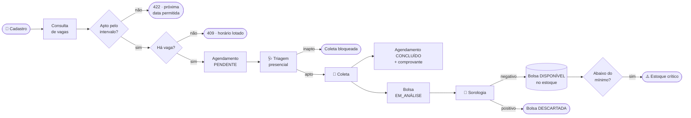
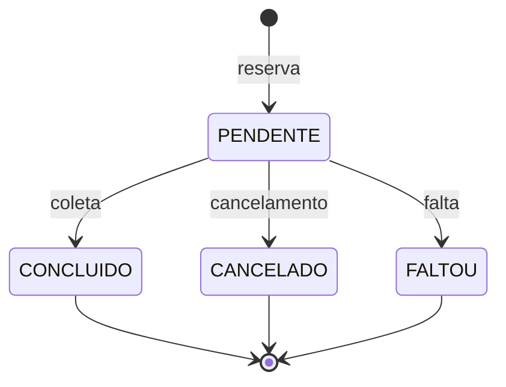
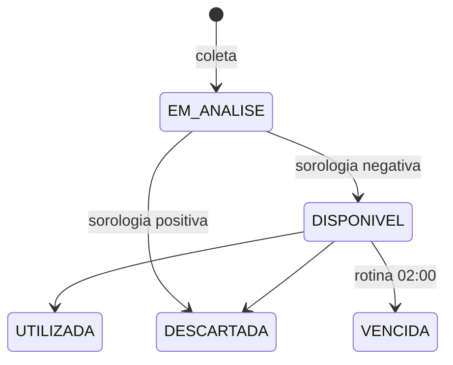
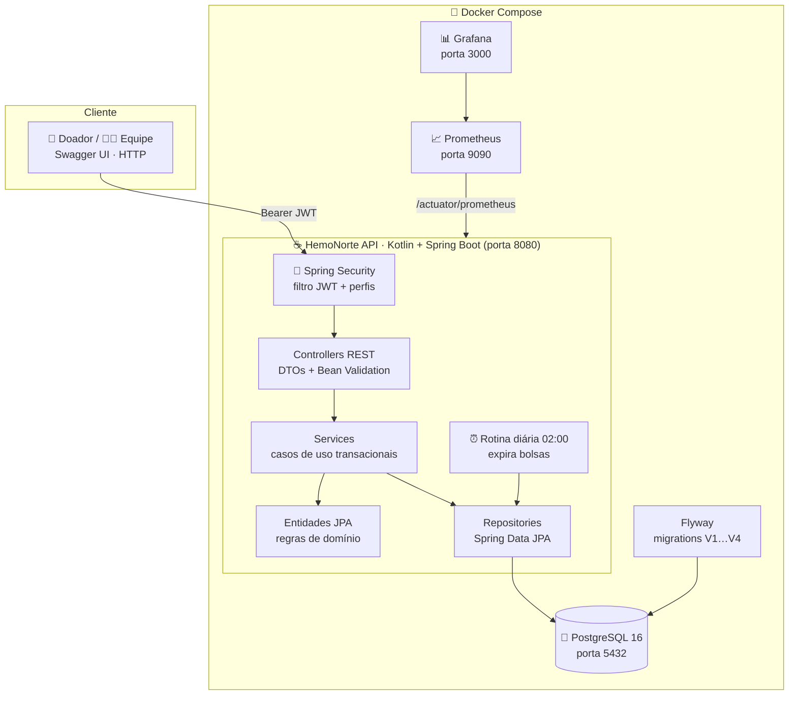

<div align="center">

# 🩸 HemoNorte

**Sistema de doação de sangue e agendamento hemoterápico**

Do cadastro do doador até a bolsa liberada no estoque: agenda com controle de vagas, triagem presencial, coleta com comprovante digital, sorologia e alerta de estoque crítico.


</div>

---

## 📌 Sumário

- [O que o sistema faz](#-o-que-o-sistema-faz)
- [Jornada da doação](#-jornada-da-doação)
- [Arquitetura e tecnologias](#️-arquitetura-e-tecnologias)
- [Regras de negócio](#-regras-de-negócio)
- [Como executar](#-como-executar)
- [Autenticação e perfis](#-autenticação-e-perfis)
- [API](#-api)
- [Testes e CI](#-testes-e-ci)
- [Estado do projeto](#-estado-do-projeto)
- [Modelagem](#-modelagem)

---

## 💡 O que o sistema faz

O HemoNorte organiza o trabalho de um hemocentro em uma API REST. Cada ator vê só o que precisa:

| Ator | O que faz no sistema |
|---|---|
| 🧑 **Doador** | Cadastra-se, consulta horários livres, agenda e cancela doações, acompanha seus agendamentos e recebe o comprovante digital |
| 🩺 **Triagem** | Registra a avaliação presencial (peso, tatuagem, cirurgia, febre) e marca faltas |
| 💉 **Coleta** | Registra a coleta de quem foi aprovado na triagem, gerando a bolsa de sangue |
| 🔬 **Laboratório** | Registra a sorologia (HIV, hepatite, Chagas), que libera ou descarta a bolsa |
| 🛡️ **Admin** | Gerencia funcionários, horários, limites de estoque e tem acesso a todas as operações |
| ⚙️ **Sistema** | Valida intervalo entre doações, protege a última vaga contra concorrência e expira bolsas vencidas às 02:00 |

---

## 🔄 Jornada da doação



### Ciclo de vida

<table>
<tr>
<td width="50%" valign="top">

**Agendamento**



</td>
<td width="50%" valign="top">

**Bolsa de sangue**



</td>
</tr>
</table>

---

## 🏗️ Arquitetura e tecnologias

Monólito em camadas: os **controllers** recebem a requisição e checam o perfil, os **services** orquestram cada caso de uso numa transação, as **entidades** guardam as regras de negócio e os **repositories** falam com o banco.



| Camada | Tecnologia | Para quê |
|---|---|---|
| Linguagem | **Kotlin 2.3** sobre **JDK 17** | Código conciso e null-safe na JVM |
| Framework | **Spring Boot 4.1** (Web MVC, Data JPA, Validation) | API REST, injeção de dependência, transações |
| Segurança | **Spring Security** + **JJWT** + **BCrypt** | Login stateless por token e senhas com hash |
| Banco | **PostgreSQL 16** + **Hibernate** | Persistência relacional com travas e índices |
| Migrações | **Flyway** (`ddl-auto: validate`) | Esquema versionado; o Hibernate só valida |
| Documentação | **springdoc-openapi** | Swagger UI e `/v3/api-docs` (protegidos por token) |
| Observabilidade | **Actuator** + **Micrometer** + **Prometheus** + **Grafana** | Saúde da aplicação e métricas |
| Testes | **JUnit 5**, **Mockito**, **MockMvc**, **Testcontainers**, **JaCoCo** | Unidade, integração com PostgreSQL real e cobertura |
| Entrega | **Docker** (build multi-stage) + **GitHub Actions** | Ambiente reproduzível e CI a cada push/PR |

---

## 📏 Regras de negócio

| Regra | Como é garantida |
|---|---|
| **Intervalo entre doações:** 60 dias (M) e 90 dias (F); até 4 (M) ou 3 (F) doações em 365 dias | `RegraAptidaoDoacao`, contando só agendamentos `CONCLUIDO`, no fuso `America/Fortaleza`. Recusa com **422** e a próxima data permitida |
| **Capacidade do horário** nunca é ultrapassada, mesmo com duas pessoas disputando a última vaga | Trava pessimista (`SELECT … FOR UPDATE`) no slot dentro da transação. Só reservas `PENDENTE` ocupam vaga |
| **Uma reserva ativa** por doador em cada horário, e nunca em horário passado | Índice único parcial no banco (V4) e validação no serviço → **409** / **400** |
| **Triagem:** peso mínimo de 50 kg; tatuagem, cirurgia ou febre recentes tornam o doador inapto | Calculado na entidade `Triagem`; o cliente não consegue enviar o resultado pronto |
| **Coleta** só com agendamento `PENDENTE` e triagem apta | `BolsaSangueService`; a coleta conclui o agendamento e emite o comprovante na mesma transação |
| **Sorologia:** todos negativos liberam a bolsa; qualquer positivo descarta; bolsa vencida nunca é liberada | `ExameSorologico` calcula o resultado; o serviço aplica a transição da bolsa |
| **Estoque disponível** conta só bolsas `DISPONIVEL` dentro da validade | Consulta agrupada por tipagem; tipagem com quantidade igual ou abaixo do mínimo aparece como crítica |

Os parâmetros clínicos são **acadêmicos e fictícios**; veja [Parâmetros da aptidão](docs/parametros-clinicos-aptidao.md). O sistema não substitui orientação médica.

---

## 🚀 Como executar

### Pré-requisitos

- **Docker** Desktop/Engine com Compose v2
- **JDK 17** (só para rodar testes fora do Docker). O Maven Wrapper já vem no projeto.

### 1. Defina o segredo do JWT

O `JWT_SECRET` é obrigatório (mínimo de 64 bytes) e não fica no repositório.

<details open>
<summary><b>Linux / macOS / WSL</b></summary>

```bash
export JWT_SECRET=$(head -c 64 /dev/urandom | base64 -w0)
```
</details>

<details>
<summary><b>Windows (PowerShell)</b></summary>

```powershell
$jwtBytes = New-Object byte[] 64
[System.Security.Cryptography.RandomNumberGenerator]::Fill($jwtBytes)
$env:JWT_SECRET = [Convert]::ToBase64String($jwtBytes)
```
</details>

Opcional: `JWT_EXPIRATION` em milissegundos (padrão 24 h).

### 2. Suba os serviços

```bash
docker compose up --build
```

| Serviço | Endereço |
|---|---|
| API | http://localhost:8080 |
| Swagger UI | http://localhost:8080/swagger-ui.html (exige token) |
| Saúde | http://localhost:8080/actuator/health |
| PostgreSQL | `localhost:5432` (banco `hemonorte`) |
| Prometheus | http://localhost:9090 |
| Grafana | http://localhost:3000 |

### 3. Primeiro acesso

Na primeira inicialização sem nenhum `ADMIN`, o sistema cria a matrícula **`admin`** com uma senha aleatória e a mostra **uma única vez** no log:

```bash
docker logs hemonorte_app | grep "ADMIN inicial"
```

Troque essa senha depois de entrar.

### Parar e limpar

```bash
docker compose down      # para os serviços, mantém os dados
docker compose down -v   # apaga também o volume hemonorte_postgres_data
```

---

## 🔐 Autenticação e perfis

```http
POST /auth/login/funcionario
Content-Type: application/json

{"matricula":"admin","senha":"senha-exibida-no-log"}
```

```http
POST /auth/login/doador
Content-Type: application/json

{"cpf":"12345678901","senha":"sua-senha"}
```

Envie o token em todas as rotas protegidas: `Authorization: Bearer eyJ...`

- O doador acessa só os próprios dados (`/api/doador/me`); IDs de terceiros enviados na requisição são ignorados.
- O funcionário tem um perfil: `TRIAGEM`, `COLETA`, `LABORATORIO` ou `ADMIN`.
- O usuário é relido do banco a cada requisição: um funcionário desativado perde o acesso na hora (**401**), mesmo com token válido.

---

## 📡 API

| Recurso | Rotas principais | Quem acessa |
|---|---|---|
| **Login** | `POST /auth/login/doador` · `POST /auth/login/funcionario` | Público |
| **Doador** | `POST /api/doador` (cadastro) · `GET/PUT /api/doador/me` · `GET /api/doador/me/agendamentos` | Público (cadastro) · Doador |
| **Funcionários** | `GET/POST /api/funcionario` · `PUT/DELETE /api/funcionario/{id}` | Admin |
| **Horários** | `GET /slots?inicio&fim` (vagas livres) · `POST/PUT/DELETE /slots` | Público (consulta) · Admin |
| **Aptidão** | `GET /doadores/{id}/aptidao` | Doador · Triagem · Admin |
| **Agendamentos** | `POST /agendamentos` · `GET /agendamentos/{id}` · `PATCH /{id}/cancelar` · `PATCH /{id}/falta` · `GET /agendamentos` | Doador · Triagem · Coleta · Admin |
| **Triagem** | `POST /triagens` · `GET /triagens/agendamento/{id}` | Triagem · Coleta (consulta) · Admin |
| **Coleta** | `POST /coletas` · `GET /coletas` | Coleta · Admin |
| **Sorologia** | `POST /exames-sorologicos` · `GET /exames-sorologicos/bolsa/{id}` | Laboratório · Admin |
| **Estoque** | `GET /estoque/disponiveis` · `GET /estoque/criticos` · `PUT /estoque/minimos` · `GET /estoque/pendentes` | Coleta · Laboratório · Admin |

Os erros seguem o formato `{"erro": "mensagem"}`:

| Código | Quando |
|---|---|
| `400` | Dados inválidos ou transição de estado não permitida |
| `401` | Token ausente, inválido ou de funcionário desativado |
| `403` | Perfil sem permissão ou recurso de outro doador |
| `404` | Recurso inexistente |
| `409` | Horário lotado, duplicidade, estado incompatível ou alteração simultânea |
| `422` | Doador inapto pelo intervalo (corpo traz `motivo` e `proximaDataPermitida`) |

Exemplos prontos: [`hemonorte-api.http`](hemonorte-api.http) e [coleção do Postman](hemonorte.postman_collection.json).

---

## 🧪 Testes e CI

```bash
./mvnw clean verify            # build + todos os testes + cobertura (o mesmo que o CI)
./mvnw test -Dgroups=unit      # só testes unitários, sem Docker
./mvnw test -Dtest=TriagemIntegrationTest   # uma classe específica
```

No Windows, use `.\mvnw.cmd` no lugar de `./mvnw`.

| Tipo | O que cobre |
|---|---|
| **Unitários** (`@Tag("unit")`) | Regras das entidades, serviços com Mockito, controllers com MockMvc e validação dos DTOs |
| **Integração** (`@Tag("integration")`) | PostgreSQL real via Testcontainers: migrations, segurança por perfil, concorrência na última vaga, triagem duplicada simultânea e a jornada completa até o estoque |

Os testes de integração precisam do Docker em execução. Relatórios: `target/surefire-reports/` (JUnit) e `target/site/jacoco/` (cobertura).

O **GitHub Actions** roda `./mvnw clean verify` em todo push e pull request para `develop` e `main`, e publica os relatórios JUnit e JaCoCo como artefatos.

---

## 📊 Estado do projeto

| Etapa | Situação |
|---|---|
| Cadastro, login JWT e perfis | ✅ Pronto |
| Horários, aptidão 60/90 e agendamento com proteção da última vaga | ✅ Pronto |
| Triagem presencial | ✅ Pronto |
| Coleta com comprovante digital | ✅ Pronto |
| Sorologia liberando ou descartando a bolsa | ✅ Pronto |
| Estoque por tipagem e alerta crítico | ✅ Pronto |
| Trilha de auditoria das bolsas | 🚧 Modelada, ainda não gravada |
| Pré-triagem digital pelo doador | 🚧 Pendente |
| Interface gráfica | 🚧 Pendente (protótipos na documentação) |

---

## 📐 Modelagem

- [Modelagem consolidada](docs/modelagem-hemonorte.md) · [PDF](docs/modelagem-hemonorte.pdf)
- [Modelo lógico do banco](docs/modelagem/modelo-logico-banco.png)
- [Sequência do agendamento](docs/modelagem/diagrama-sequencia-agendamento.png)


[Versão vetorial (SVG)](docs/diagrama-de-classes.svg) · [Fonte PlantUML](docs/diagrama-de-classes.puml)

---

<div align="center">
<sub>Projeto A3 · Gestão de Qualidade de Software</sub>
</div>
