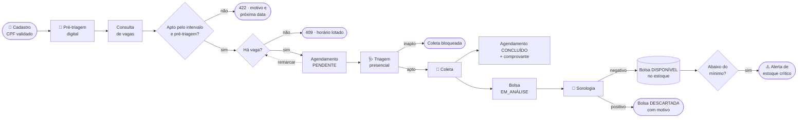
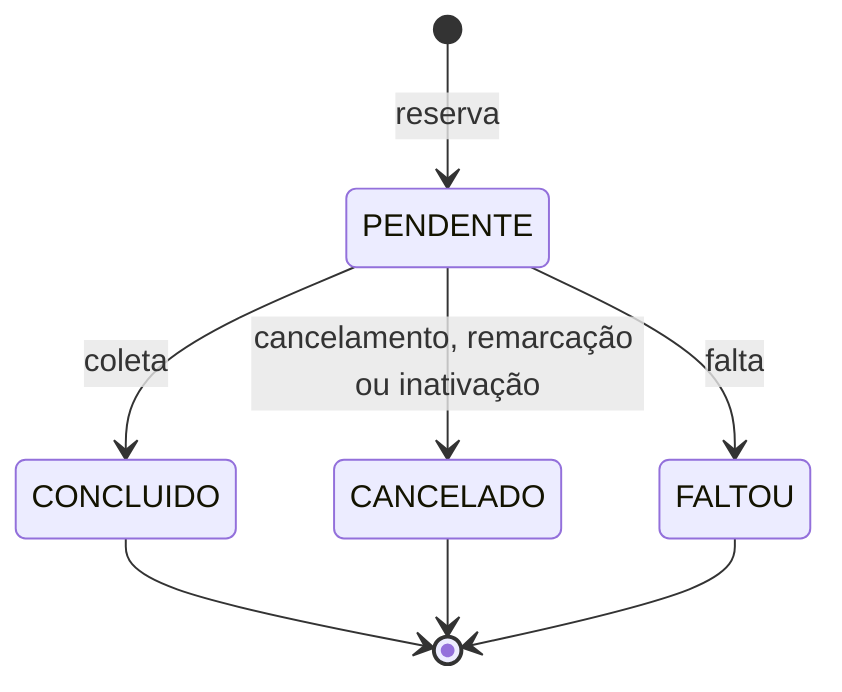
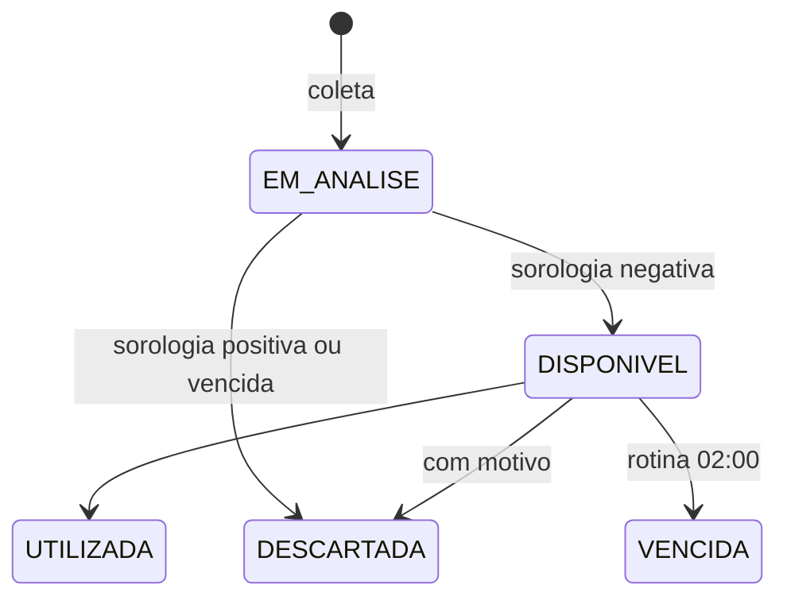
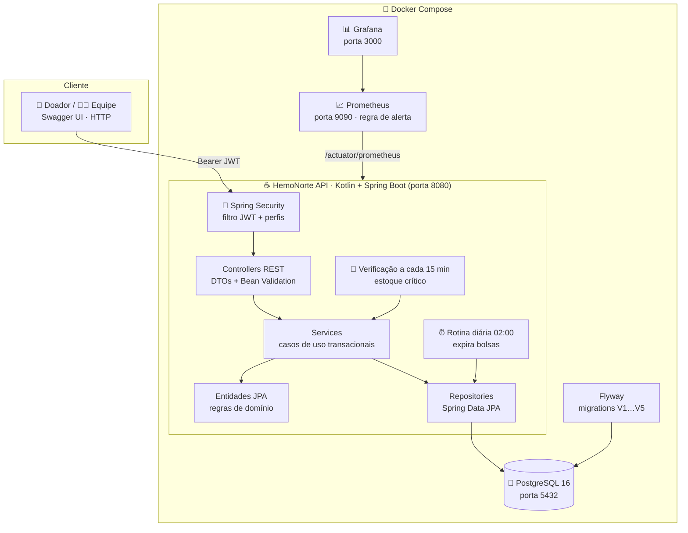
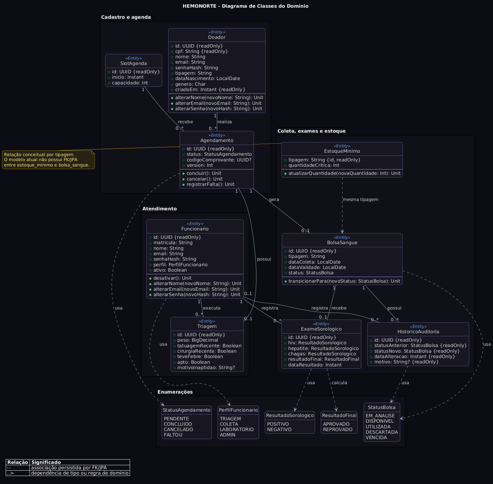

<div align="center">

# 🩸 HemoNorte

**Sistema de doação de sangue e agendamento hemoterápico**

Do cadastro do doador até a bolsa liberada no estoque: pré-triagem digital, agenda com controle de vagas, triagem presencial, coleta com comprovante digital, sorologia, trilha de auditoria e alerta automático de estoque crítico.


</div>

---

## 📌 Sumário

- [Números do projeto](#-números-do-projeto)
- [O que o sistema faz](#-o-que-o-sistema-faz)
- [Jornada da doação](#-jornada-da-doação)
- [Requisitos atendidos](#-requisitos-atendidos)
- [Arquitetura e tecnologias](#️-arquitetura-e-tecnologias)
- [Regras de negócio](#-regras-de-negócio)
- [Segurança e LGPD](#-segurança-e-lgpd)
- [Como executar](#-como-executar)
- [Autenticação e perfis](#-autenticação-e-perfis)
- [API](#-api)
- [Testes, qualidade e CI](#-testes-qualidade-e-ci)
- [Desempenho](#-desempenho)
- [Observabilidade e alertas](#-observabilidade-e-alertas)
- [Estrutura do projeto](#-estrutura-do-projeto)
- [Estado final do projeto](#-estado-final-do-projeto)
- [Documentação e modelagem](#-documentação-e-modelagem)

---

## 📈 Números do projeto

Medidos em 10/11/2026 com `./mvnw clean verify`.

| Indicador | Valor |
|---|---|
| Testes automatizados | **228**, todos passando: 185 unitários, 42 de integração e 1 de contexto |
| Testes em banco real | **43**, com PostgreSQL 16 via Testcontainers |
| Cobertura de linhas (JaCoCo) | **85,6%** (desvios: 73,2%; instruções: 83,3%) |
| p95 da consulta de vagas (`GET /slots`) | **31–36 ms**, com meta de 500 ms |
| p95 da reserva (`POST /agendamentos`) | **9–12 ms**, com meta de 500 ms |
| Requisitos funcionais | **11 de 11** implementados e testados |
| Requisitos não funcionais | **5 de 6** comprovados; falta a interface (RNF05) |
| Endpoints REST | **52**, em 12 controllers |
| Código | 92 arquivos Kotlin de produção (~3.800 linhas) e 40 de teste (~4.700 linhas) |
| Migrations Flyway | **5** (V1 a V5) |

---

## 💡 O que o sistema faz

O HemoNorte organiza o trabalho de um hemocentro em uma API REST. Cada ator vê só o que precisa:

| Ator | O que faz no sistema |
|---|---|
| 🧑 **Doador** | Cadastra-se, responde a pré-triagem digital, consulta horários livres, agenda, remarca e cancela, acompanha seu histórico de doações e recebe o comprovante digital |
| 🩺 **Triagem** | Registra a avaliação presencial (peso, tatuagem, cirurgia, febre) e marca faltas |
| 💉 **Coleta** | Registra a coleta de quem foi aprovado na triagem, gerando a bolsa de sangue e o comprovante |
| 🔬 **Laboratório** | Registra a sorologia (HIV, hepatite, Chagas), que libera ou descarta a bolsa |
| 🛡️ **Admin** | Gerencia funcionários, doadores, horários e limites de estoque, e tem acesso a todas as operações |
| 🌐 **Público** | Valida a autenticidade de um comprovante pelo código |
| ⚙️ **Sistema** | Valida intervalo entre doações e pré-triagem, protege a última vaga, audita cada mudança de bolsa, expira bolsas vencidas às 02:00 e emite alerta de estoque crítico a cada 15 minutos |

---

## 🔄 Jornada da doação



### Ciclo de vida

<table>
<tr>
<td width="50%" valign="top">

**Agendamento**



</td>
<td width="50%" valign="top">

**Bolsa de sangue** (toda transição gera registro de auditoria)



</td>
</tr>
</table>

---

## ✅ Requisitos atendidos

### Funcionais

| ID | Requisito | Como foi atendido |
|---|---|---|
| RF01 | Cadastro do doador com CPF, contato, nascimento e tipagem | CPF validado pelo Módulo 11; CPF ou e-mail duplicado → 409 |
| RF02 | Consultar, atualizar e excluir conforme retenção | Exclusão inativa o doador, cancela reservas pendentes e preserva o histórico |
| RF03 | Pré-triagem digital antes de escolher vaga | Questionário com respostas, resultado e motivo; vale 7 dias e é exigido na reserva |
| RF04 | Intervalo de 60 (M) / 90 (F) dias | `RegraAptidaoDoacao`; 422 com a próxima data permitida |
| RF05 | Vagas, reserva sem exceder capacidade e remarcação | Trava pessimista no horário, índice único parcial e remarcação atômica |
| RF06 | Cancelar ou registrar falta | Transições da entidade `Agendamento` |
| RF07 | Triagem e coleta só com doador apto; histórico | Coleta exige triagem apta; `GET /api/doador/me/doacoes` |
| RF08 | Bolsa vinculada à coleta, liberada ou descartada após exame | Exame define o destino; descarte exige motivo; tudo auditado |
| RF09 | Estoque por tipagem e alerta abaixo do mínimo | Contagem por tipagem; job a cada 15 min com métrica e alerta no Prometheus |
| RF10 | Comprovante digital com código único | Emitido na coleta e validável publicamente em `GET /comprovantes/{codigo}` |
| RF11 | Funcionários, perfis e acesso | JWT com perfis `TRIAGEM`, `COLETA`, `LABORATORIO` e `ADMIN` |

### Não funcionais

| ID | Exigência | Evidência | Situação |
|---|---|---|---|
| RNF01 | Sigilo e LGPD | Perfis, BCrypt, auditoria imutável, testes de acesso negado, perfil `demo` com dados fictícios | ✅ |
| RNF02 | Regras de aptidão corretas nos limites | Testes D+59/D+60, D+89/D+90, peso 49,99/50 e cada impedimento | ✅ |
| RNF03 | Vagas e agendamento em menos de 500 ms | `DesempenhoIntegrationTest` + [relatório](docs/relatorio-desempenho.md) | ✅ |
| RNF04 | Integridade de estoque e agenda | Concorrência na última vaga, rollback de coleta, exames simultâneos, remarcação com falha | ✅ |
| RNF05 | Interface clara e acessível | Ainda não há interface | 🚧 |
| RNF06 | Repetibilidade da entrega | Docker Compose, Flyway e CI com testes | ✅ |

---

## 🏗️ Arquitetura e tecnologias

Monólito em camadas com **modelo de domínio rico**: os **controllers** recebem a requisição e checam o perfil, os **services** orquestram cada caso de uso numa transação, as **entidades** guardam as regras de negócio (transições com `require(...)`) e os **repositories** falam com o banco.



| Camada | Tecnologia | Para quê |
|---|---|---|
| Linguagem | **Kotlin 2.3.21** sobre **JDK 17** | Código conciso e null-safe na JVM |
| Framework | **Spring Boot 4.1.1** (Web MVC, Data JPA, Validation, Scheduling) | API REST, injeção de dependência, transações e rotinas agendadas |
| Segurança | **Spring Security** + **JJWT 0.12.6** + **BCrypt** | Login stateless por token e senhas com hash |
| Banco | **PostgreSQL 16** + **Hibernate** | Persistência relacional com travas, índices parciais e trigger |
| Migrações | **Flyway** (`ddl-auto: validate`) | Esquema versionado; o Hibernate só valida |
| Documentação | **springdoc-openapi 3.1** | Swagger UI e `/v3/api-docs` públicos; as rotas documentadas exigem token |
| Observabilidade | **Actuator** + **Micrometer** + **Prometheus** + **Grafana** | Saúde, latência (histograma e SLO de 500 ms) e métricas de estoque |
| Testes | **JUnit 5**, **Mockito**, **MockMvc**, **Testcontainers**, **JaCoCo** | Unidade, integração com PostgreSQL real e cobertura |
| Entrega | **Docker** (build multi-stage) + **GitHub Actions** | Ambiente reproduzível e CI a cada push/PR |

---

## 📏 Regras de negócio

| Regra | Como é garantida |
|---|---|
| **CPF válido**: dígitos verificadores pelo Módulo 11; sequências repetidas são recusadas | Validação na entidade `Doador` → **400** |
| **Pré-triagem**: peso mínimo de 50 kg; tatuagem, cirurgia ou febre recentes tornam inapto; vale 7 dias | `RegraTriagem` (a mesma da triagem presencial); sem pré-triagem válida e apta a reserva recebe **422** |
| **Intervalo entre doações:** 60 dias (M) e 90 dias (F); até 4 (M) ou 3 (F) doações em 365 dias | `RegraAptidaoDoacao`, contando só agendamentos `CONCLUIDO`, no fuso `America/Fortaleza`. Recusa com **422** e a próxima data permitida |
| **Capacidade do horário** nunca é ultrapassada, mesmo com duas pessoas disputando a última vaga | Trava pessimista (`SELECT … FOR UPDATE`) no slot dentro da transação. Só reservas `PENDENTE` ocupam vaga |
| **Uma reserva ativa** por doador em cada horário, e nunca em horário passado | Índice único parcial no banco (V4) e validação no serviço → **409** / **400** |
| **Remarcação** cancela a reserva atual e reserva o novo horário de uma vez | Mesma transação: se o novo horário falhar, a reserva original é mantida |
| **Triagem presencial:** mesmos critérios da pré-triagem | Calculado na entidade `Triagem`; o cliente não consegue enviar o resultado pronto |
| **Coleta** só com agendamento `PENDENTE` e triagem apta | `BolsaSangueService`; a coleta conclui o agendamento e emite o comprovante na mesma transação |
| **Sorologia:** todos negativos liberam a bolsa; qualquer positivo descarta; bolsa vencida nunca é liberada | `ExameSorologico` calcula o resultado; o serviço aplica a transição e grava a auditoria |
| **Descarte** sempre com motivo | `BolsaSangue.transicionarPara` recusa descarte sem motivo |
| **Estoque disponível** conta só bolsas `DISPONIVEL` dentro da validade | Consulta agrupada por tipagem; tipagem com quantidade igual ou abaixo do mínimo é crítica |
| **Inativação do doador** preserva o histórico | Doador fica `ativo = false`, reservas pendentes são canceladas e o login passa a dar **401** |

Os parâmetros clínicos são **acadêmicos e fictícios**; veja [Parâmetros da aptidão](docs/parametros-clinicos-aptidao.md). O sistema não substitui orientação médica.

---

## 🔒 Segurança e LGPD

- **Autenticação stateless** com JWT; o segredo (`JWT_SECRET`, ≥ 64 bytes) nunca fica no repositório.
- **Senhas** com BCrypt; o hash nunca aparece nas respostas.
- **Perfis** em duas camadas: regras por URL no `SecurityConfig` (terminando em `denyAll`) e `@PreAuthorize` em cada endpoint.
- **Dados do próprio doador** vêm sempre do token (`/api/doador/me`), nunca de um ID enviado na requisição.
- **Usuário relido a cada requisição**: funcionário ou doador desativado perde o acesso na hora.
- **Trilha de auditoria imutável**: cada mudança de status da bolsa grava quem, quando, de/para e motivo; um trigger no banco (V5) bloqueia `UPDATE` e `DELETE` em `historico_auditoria`.
- **Comprovante público** mostra só nome, código e data, sem CPF nem dado clínico.
- **Retenção**: excluir um doador o inativa, preservando o histórico clínico.
- **Demonstração** apenas com dados fictícios (perfil `demo`).

---

## 🚀 Como executar

### Pré-requisitos

- **Docker** Desktop/Engine com Compose v2
- **JDK 17+** (só para rodar testes fora do Docker). O Maven Wrapper já vem no projeto.

### 1. Defina o segredo do JWT

O `JWT_SECRET` é obrigatório (mínimo de 64 bytes) e não fica no repositório.

<details open>
<summary><b>Linux / macOS / WSL</b></summary>

```bash
export JWT_SECRET=$(head -c 64 /dev/urandom | base64 -w0)
```
</details>

<details>
<summary><b>Windows (PowerShell)</b></summary>

```powershell
$jwtBytes = New-Object byte[] 64
[System.Security.Cryptography.RandomNumberGenerator]::Fill($jwtBytes)
$env:JWT_SECRET = [Convert]::ToBase64String($jwtBytes)
```
</details>

### 2. Suba os serviços

```bash
docker compose up --build
```

| Serviço | Endereço |
|---|---|
| API | http://localhost:8080 |
| Swagger UI | http://localhost:8080/swagger-ui.html (público; lê o arquivo `openapi.yaml`; use **Authorize** com o token para chamar as rotas) |
| Saúde | http://localhost:8080/actuator/health |
| Métricas | http://localhost:8080/actuator/prometheus |
| PostgreSQL | `localhost:5432` (banco `hemonorte`) |
| Prometheus | http://localhost:9090 (aba *Alerts* mostra `EstoqueSangueCritico`) |
| Grafana | http://localhost:3000 |

### 3. Primeiro acesso

Na primeira inicialização sem nenhum `ADMIN`, o sistema cria a matrícula **`admin`** com uma senha aleatória e a mostra **uma única vez** no log:

```bash
docker logs hemonorte_app | grep "ADMIN inicial"
```

Troque essa senha depois de entrar.

### 4. Dados fictícios para demonstração (opcional)

```bash
SPRING_PROFILES_ACTIVE=demo docker compose up --build
```

O perfil `demo` cria, uma única vez, dados **fictícios**: funcionários `triagem.demo`, `coleta.demo` e `laboratorio.demo`; doadores com CPF `52998224725`, `11144477735` e `22255588846`; 15 horários nos próximos 5 dias e estoque mínimo 3 para cada tipagem. A senha de todos é `Demo-12345`. Nenhum dado real deve ser usado na demonstração.

### Variáveis de ambiente

| Variável | Obrigatória | Padrão | Uso |
|---|---|---|---|
| `JWT_SECRET` | sim | — | Chave de assinatura dos tokens (base64, ≥ 64 bytes) |
| `JWT_EXPIRATION` | não | `86400000` | Validade do token em ms (24 h) |
| `SPRING_PROFILES_ACTIVE` | não | vazio | `demo` cria os dados fictícios |
| `SPRING_DATASOURCE_URL` | não | `jdbc:postgresql://localhost:5432/hemonorte` | Banco (o Compose aponta para o serviço `db`) |
| `HEMONORTE_ALERTAESTOQUE_INTERVALO` | não | `PT15M` | Intervalo da verificação de estoque crítico |

### Parar e limpar

```bash
docker compose down      # para os serviços, mantém os dados
docker compose down -v   # apaga também o volume hemonorte_postgres_data
```

---

## 🔐 Autenticação e perfis

```http
POST /auth/login/funcionario
Content-Type: application/json

{"matricula":"admin","senha":"senha-exibida-no-log"}
```

```http
POST /auth/login/doador
Content-Type: application/json

{"cpf":"52998224725","senha":"sua-senha"}
```

Envie o token em todas as rotas protegidas: `Authorization: Bearer eyJ...`

| Perfil | Pode |
|---|---|
| Doador (`TIPO_DOADOR`) | Próprios dados, pré-triagem, agendar, remarcar, cancelar, histórico |
| `TRIAGEM` | Triagem, falta, consulta de agendamentos e aptidão |
| `COLETA` | Coleta, consulta de triagem, estoque |
| `LABORATORIO` | Sorologia, bolsas pendentes, estoque |
| `ADMIN` | Tudo, incluindo funcionários, doadores, horários e limites de estoque |

---

## 📡 API

| Recurso | Rotas principais | Quem acessa |
|---|---|---|
| **Login** | `POST /auth/login/doador` · `POST /auth/login/funcionario` | Público |
| **Doador** | `POST /api/doador` (cadastro) · `GET/PUT/DELETE /api/doador/me` · `PUT /api/doador/me/senha` · `GET /api/doador/me/agendamentos` · `GET /api/doador/me/doacoes` | Público (cadastro) · Doador |
| **Doador (gestão)** | `GET /api/doador` · `GET/PUT/DELETE /api/doador/{id}` · `PUT /api/doador/{id}/senha` | Admin (consulta: Triagem e Coleta) |
| **Pré-triagem** | `GET /api/doador/me/pre-triagem/perguntas` · `POST /api/doador/me/pre-triagem` · `GET /api/doador/me/pre-triagem` | Doador |
| **Comprovante** | `GET /comprovantes/{codigo}` | Público |
| **Funcionários** | `GET/POST /api/funcionario` · `GET/PUT/DELETE /api/funcionario/{id}` · `PUT /api/funcionario/{id}/senha` | Admin |
| **Horários** | `GET /slots?inicio&fim` (vagas livres) · `POST/PUT/DELETE /slots` | Público (consulta) · Admin |
| **Aptidão** | `GET /doadores/{id}/aptidao` | Doador · Triagem · Admin |
| **Agendamentos** | `POST /agendamentos` · `GET /agendamentos` · `GET /agendamentos/{id}` · `PATCH /{id}/cancelar` · `PATCH /{id}/remarcar` · `PATCH /{id}/falta` | Doador · Triagem · Coleta · Admin |
| **Triagem** | `POST /triagens` · `GET /triagens` · `GET /triagens/agendamento/{id}` | Triagem · Coleta (consulta) · Admin |
| **Coleta** | `POST /coletas` · `GET /coletas` | Coleta · Admin |
| **Sorologia** | `POST /exames-sorologicos` · `GET /exames-sorologicos` · `GET /exames-sorologicos/{id}` · `GET /exames-sorologicos/bolsa/{id}` | Laboratório · Admin |
| **Estoque** | `GET /estoque/disponiveis` · `GET /estoque/criticos` · `GET /estoque/pendentes` · `PUT /estoque/minimos` · `PUT /estoque/{id}` (descarte exige `motivo`) · `GET /estoque/{id}/historico` | Coleta · Laboratório · Admin |

Os erros seguem o formato `{"erro": "mensagem"}`:

| Código | Quando |
|---|---|
| `400` | Dados inválidos (inclui CPF inválido), descarte sem motivo ou transição de estado não permitida |
| `401` | Token ausente, inválido ou de usuário desativado |
| `403` | Perfil sem permissão ou recurso de outro doador |
| `404` | Recurso inexistente |
| `409` | Horário lotado, duplicidade, estado incompatível ou alteração simultânea |
| `422` | Doador inapto pelo intervalo ou pela pré-triagem (corpo traz `motivo` e `proximaDataPermitida`) |

Exemplos prontos: [`hemonorte-api.http`](hemonorte-api.http).

---

## 🧪 Testes, qualidade e CI

```bash
./mvnw clean verify                          # build + todos os testes + cobertura (o mesmo que o CI)
./mvnw test -Dgroups=unit                    # só unitários, sem Docker (~30 s)
./mvnw test -Dgroups=integration             # só integração, precisa do Docker
./mvnw test -Dtest=FluxoDoadorIntegrationTest -Dgroups=integration   # uma classe
```

No Windows, use `.\mvnw.cmd` no lugar de `./mvnw`. No WSL com um JDK do Windows no `JAVA_HOME`, use `JAVA_HOME=/usr/lib/jvm/java-21-openjdk-amd64 ./mvnw ...`.

### Quantos testes e onde

| Grupo | Testes | O que cobre |
|---|---|---|
| Modelo (`model/`) | 92 | Entidades e regras puras: CPF, tipagem, transições, auditoria, aptidão 60/90, pré-triagem |
| Serviços (`service/`) | 60 | Casos de uso com Mockito: reserva, remarcação, histórico, coleta, sorologia, estoque, alertas, comprovante |
| Controllers (`controller/`) | 23 | MockMvc standalone e mapeamento de erros |
| DTOs (`dto/`) | 9 | Bean Validation das requisições |
| Repositório | 1 | Trava pessimista do slot |
| **Integração** (`integration/`) | **42** | PostgreSQL real: migrations, segurança por perfil, documentação OpenAPI em dia com o código, pré-triagem, concorrência, rollback, auditoria imutável, desempenho e dados de demonstração |
| Contexto | 1 | A aplicação sobe com o esquema validado |
| **Total** | **228** | 0 falhas, 0 ignorados |

### Cobertura (JaCoCo)

| Pacote | Linhas cobertas |
|---|---|
| `dto` | 96,8% |
| `security` | 94,5% |
| `service` | 84,8% |
| `model` | 78,9% |
| `controller` | 74,9% |
| **Total** | **85,6%** |

### O que os testes de integração garantem

- Duas reservas simultâneas na última vaga criam **exatamente um** agendamento.
- Uma coleta que falha não deixa o agendamento concluído nem gera comprovante.
- Dois exames simultâneos na mesma bolsa gravam **um** resultado e **um** registro de auditoria.
- Uma remarcação para horário lotado mantém a reserva original.
- O banco recusa `UPDATE` e `DELETE` na trilha de auditoria.
- Cada perfil só acessa o que deve; recurso de outro doador dá 403.

Relatórios: `target/surefire-reports/` (JUnit) e `target/site/jacoco/index.html` (cobertura).

O **GitHub Actions** roda `./mvnw clean verify` em todo push e pull request para `develop` e `main`, e publica os relatórios JUnit e JaCoCo como artefatos.

---

## ⚡ Desempenho

Medido pelo `DesempenhoIntegrationTest` (roda no CI e falha se o p95 chegar a 500 ms), com 70 horários, 300 reservas já existentes e PostgreSQL real:

| Operação | p50 | p95 | Meta |
|---|---|---|---|
| `GET /slots` (7 dias) | ~22 ms | 31–36 ms | < 500 ms |
| `POST /agendamentos` | ~7 ms | 9–12 ms | < 500 ms |

Detalhes, ambiente e consulta PromQL do p95 em produção: [docs/relatorio-desempenho.md](docs/relatorio-desempenho.md).

---

## 📊 Observabilidade e alertas

| Métrica | Significado |
|---|---|
| `http_server_requests_seconds_bucket` | Histograma de latência por rota (p95 com `histogram_quantile`) e SLO de 500 ms |
| `hemonorte_estoque_disponivel{tipagem}` | Bolsas disponíveis por tipagem |
| `hemonorte_estoque_critico{tipagem}` | `1` quando a tipagem está no mínimo ou abaixo |

A regra [`EstoqueSangueCritico`](monitoring/prometheus/alertas.yaml) dispara no Prometheus quando alguma tipagem fica crítica, e o log registra `ALERTA estoque crítico` com tipagem, quantidade e mínimo.

---

## 🗂️ Estrutura do projeto

```text
src/main/kotlin/com/hemonorte/
├── controller/   12 controllers REST + ApiExceptionHandler (mapeia exceções para 400/401/403/404/409/422)
├── dto/          requisições com Bean Validation e respostas com mapeadores toResponse()
├── exception/    ConflitoException, InaptidaoDoacaoException, AutenticacaoException…
├── model/        entidades ricas (Doador, PreTriagem, Agendamento, Triagem, BolsaSangue…) e regras puras
├── repository/   Spring Data JPA
├── security/     filtro JWT, SecurityConfig, AdminInitializer e DemoDataInitializer
└── service/      casos de uso transacionais e rotinas agendadas (expiração e alerta)
src/main/resources/db/migration/   migrations Flyway V1…V5
src/test/kotlin/com/hemonorte/     testes unitários (@Tag("unit")) e integration/ (@Tag("integration"))
monitoring/                        Prometheus (scrape + alertas) e Grafana
docs/                              modelagem, diagramas, parâmetros clínicos e relatório de desempenho
```

| Migration | O que faz |
|---|---|
| V1 | Esquema inicial: doador, slot, agendamento, funcionário, triagem, bolsa, exame, estoque mínimo e auditoria |
| V2 | Data de nascimento não pode ser futura |
| V3 | Capacidade do horário positiva |
| V4 | Índice único parcial: uma reserva `PENDENTE` por doador e horário |
| V5 | Tabela `pre_triagem`, coluna `doador.ativo` e trigger de auditoria imutável |

---

## 🧭 Estado final do projeto

| Etapa | Situação |
|---|---|
| Cadastro com CPF validado, login JWT e perfis | ✅ Pronto |
| Pré-triagem digital pelo doador | ✅ Pronto |
| Horários, aptidão 60/90, agendamento, remarcação e proteção da última vaga | ✅ Pronto |
| Triagem presencial e coleta com comprovante digital | ✅ Pronto |
| Sorologia liberando ou descartando a bolsa | ✅ Pronto |
| Estoque por tipagem e alerta automático de estoque crítico | ✅ Pronto |
| Trilha de auditoria imutável das bolsas | ✅ Pronto |
| Histórico de doações e validação pública do comprovante | ✅ Pronto |
| Interface gráfica (web e celular) | ➖ Fora do escopo desta entrega (wireframes na documentação) |
| Diagramas de classes e banco | ⚠️ Não mostram a pré-triagem (V5) |

---

## 📐 Documentação e modelagem

- [Modelagem consolidada](docs/modelagem-hemonorte.md) · [PDF](docs/modelagem-hemonorte.pdf)
- [Parâmetros clínicos da aptidão e da pré-triagem](docs/parametros-clinicos-aptidao.md)
- [Relatório de desempenho (RNF03)](docs/relatorio-desempenho.md)
- [Especificação OpenAPI 3.1](src/main/resources/static/openapi.yaml) dos 52 endpoints. É o arquivo que o Swagger UI carrega (`/openapi.yaml`); também abre no [Swagger Editor](https://editor.swagger.io). O `DocumentacaoOpenApiIntegrationTest` falha se ele divergir das rotas do código. Para regenerar a partir do código: `curl -o src/main/resources/static/openapi.yaml http://localhost:8080/v3/api-docs.yaml`
- [Modelo lógico do banco](docs/modelagem/modelo-logico-banco.png)
- [Sequência do agendamento](docs/modelagem/diagrama-sequencia-agendamento.png)



[Versão vetorial (SVG)](docs/diagrama-de-classes.svg) · [Fonte PlantUML](docs/diagrama-de-classes.puml)

---

<div align="center">
<sub>Projeto A3 · Gestão de Qualidade de Software</sub>
</div>
