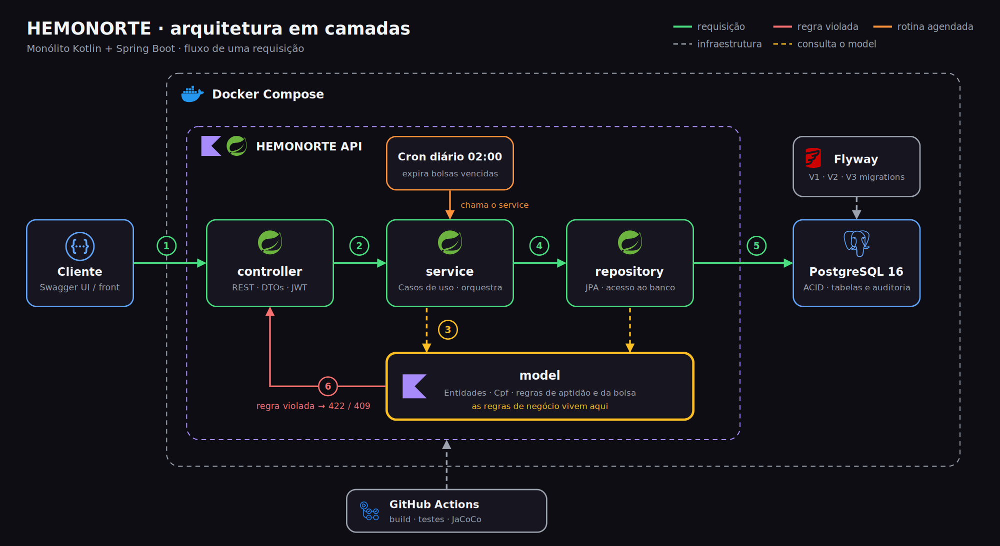
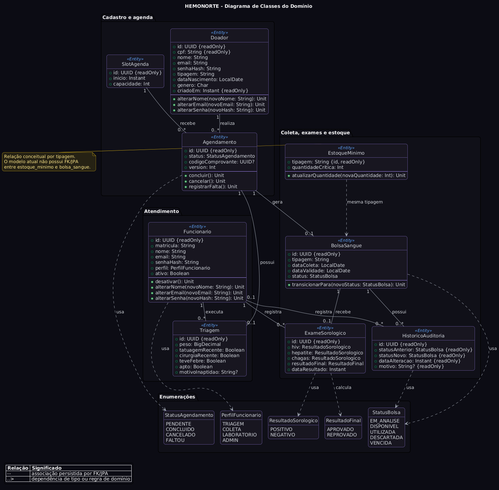
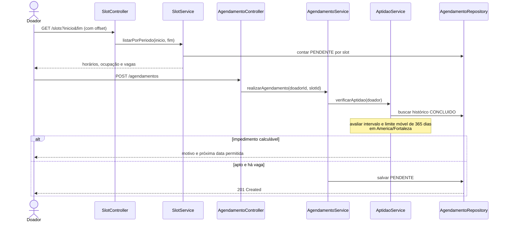

# Modelagem do Sistema Hemonorte

Sistema de doação de sangue e agendamento hemoterápico.

Este documento consolida a modelagem arquitetural, lógica e comportamental do sistema. O diagrama de classes foi derivado das entidades Kotlin/JPA e do esquema SQL presentes no projeto.

## 1. Arquitetura em camadas

## 2. Modelo lógico do banco de dados

## 3. Diagrama de classes

O vínculo entre `EstoqueMinimo` e `BolsaSangue` é conceitual, feito pela tipagem sanguínea. O modelo atual não possui chave estrangeira ou associação JPA entre essas entidades.

## 4. Diagrama de sequência do agendamento

Os parâmetros acadêmicos estão registrados em [Parâmetros da aptidão](parametros-clinicos-aptidao.md). A pré-avaliação não substitui a triagem presencial.
