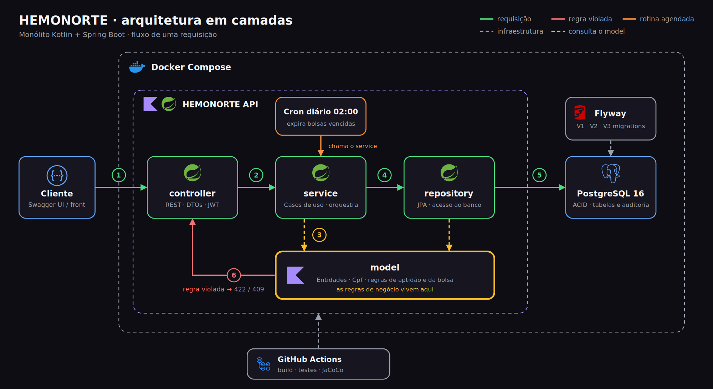
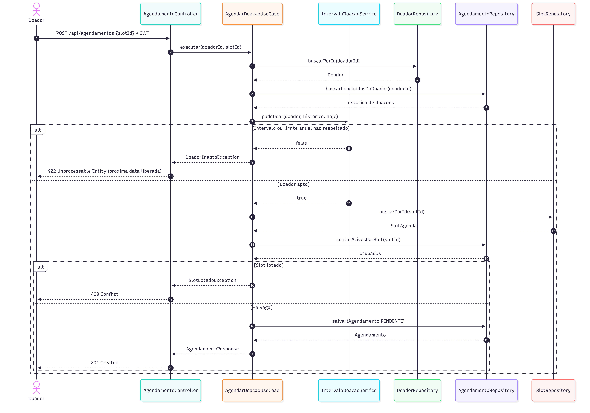

# Modelagem do Sistema Hemonorte

Sistema de doação de sangue e agendamento hemoterápico.

Este documento consolida a modelagem arquitetural, lógica e comportamental do sistema. O diagrama de classes foi derivado das entidades Kotlin/JPA e do esquema SQL presentes no projeto.

## 1. Arquitetura em camadas

Visão geral dos componentes da aplicação e do fluxo entre cliente, API e banco de dados.

## 2. Modelo lógico do banco de dados

Entidades persistidas, atributos, chaves e cardinalidades do banco de dados.

## 3. Diagrama de classes

Classes de domínio, enumerações, atributos, operações e associações implementadas no projeto.

O vínculo entre `EstoqueMinimo` e `BolsaSangue` é conceitual, feito pela tipagem sanguínea. O modelo atual não possui chave estrangeira ou associação JPA entre essas entidades.

## 4. Diagrama de sequência do agendamento

Fluxo de validação da aptidão do doador, consulta de vaga e criação do agendamento.

